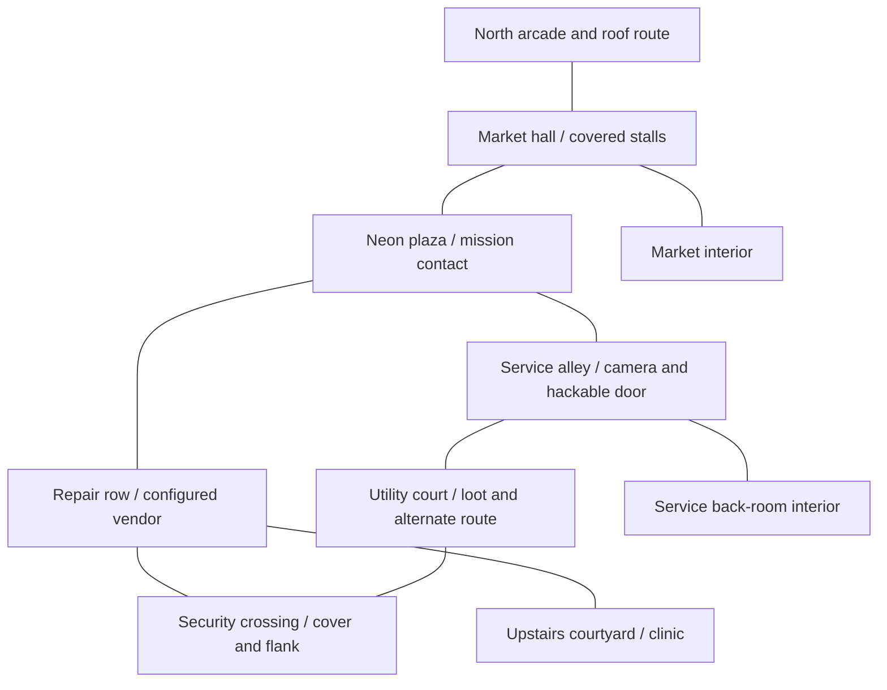

# Night Market Neighborhood — Production World Design

**Status:** Proposed for user approval before modeling or world integration.
**User-selected approach:** Build a detailed Night Market neighborhood first, then expand it into the larger continuous city.

## Intent

Replace the current greybox fixture as the place the user explores with a convincing, connected cyberpunk neighborhood at believable street scale. It must feel like a real lived-in part of the larger city, let the user test the already implemented game systems, and provide a reusable source asset kit for later districts. The current startup capture shows plain block geometry, flat surfaces and oversized near-route pillars; those are the specific deficiencies this design addresses.

## Proposed first-area scale

This is a Main Agent proposal based on the user's choice of a substantial neighborhood; the user can revise it during design approval.

- Approximately **300 m × 300 m**: a compact 3 × 3 grid of urban blocks, with 8–12 m main streets, narrower service alleys and mixed building footprints.
- About 6–8 m street width for alleys, 8–12 m main streets, and 2–6 storey building silhouettes (roughly 7–24 m). Use Blender metric units at 1 unit = 1 m.
- A readable central market plaza and covered market hall; repair/clinic storefronts; a service/utility court; rooflines, bridges and upper-floor fire escapes as skyline landmarks.
- At least two traversable loops with alternate routes. Include three authored enterable spaces: the market hall, a service/back-room route and one small upstairs or courtyard space. Measure actual route times in Godot rather than treating a proposed estimate as acceptance.
- Chunk layout and bounds are to be selected against the accepted streaming manager and measured content cost; the former 20 m fixture is not the production scale.

## Goals

- Replace flat rectangles with authored models: detailed building fronts/corners, doors, windows, market stalls, street equipment, signs, cables, pipes, HVAC, lights, bins, barriers, pavement edges and roof silhouettes. Repeat modules with authored variants and set dressing so blocks share a city identity without appearing cloned.
- Make the service door a close-up hero asset: modeled frame and jamb, layered metal leaf and inset panels, bevels, hinges, handle/lock, keypad or hack interface, status lights, decals, wear, UVs and distinct material assignments. Keep its gameplay collision simple and separate from render geometry.
- Produce real Godot-compatible PBR texture images from Blender-authored materials: base color, tangent normal, roughness, metallic, AO and emissive where needed. Bake procedural detail before export. Proposed resolution: 1K reusable tiling sets and 2K hero/close-up sets; validate memory and appearance in the integrated renderer before scaling the kit.
- Use varied, physically readable materials: wet asphalt and puddle zones, cracked and patched concrete, painted steel, oxidized metal, glass, ceramic tile, shop shutters and layered signage. Add grime, edge wear, rain streaks, graffiti/decals and emissive signs as textured or modeled details, not plain viewport colors.
- Integrate the accepted player, NPC, mission, combat, hacking, loot, inventory, healing and save/load systems into real routes. Provide cover and flanks in the combat lane, a surveilled approach plus hacked shortcut and walkable bypass, an alternate back route, and a visible reward/cache path.
- Create Blender-modeled, game-scale visual models for the featured Night Market contact (Mara) and one security guard, with clean rigs and the basic motion set needed by existing gameplay states; keep other crowds/population out of this first slice.
- Ensure at least one market contact has a working stock/trade path. Existing NPC-04 safely reports unavailable when merchant stock is not configured, so add a separate bounded inventory task rather than presenting an inactive stall as a shop.
- Keep source `.blend` files and reproducible Blender MCP/export scripts, with engine-facing `.glb` and baked maps in the existing documented source/export convention. Preserve all existing asset sources.

## Visual map proposal

The exact story content stays with authored mission/NPC tasks; the geometry must support the marked routes and clear first-person sightlines.

## Asset and engine pipeline

- Blender MCP is available and connected. Inspection shows its current scene is the untouched default scene (`Cube`, `Camera`, `Light`); do not replace or save over it. Create new editable project source under `art/source/environment/night_market/`.
- Model and UV unwrap authored architecture and props in Blender 5.2. Apply dimensions/transforms, build export-safe Principled materials, bake required maps, use named collections, create low-cost collision proxies, and retain editable source meshes/modifiers as practical.
- Export GLB with the existing Godot preset to `game/assets/environment/night_market/`. Preserve texture files, scale, pivots, normals, material map channels and names through a Godot round-trip.
- Assemble a streamed neighborhood scene under `game/world/districts/night_market/` from the imported assets and existing world lifecycle contracts. Do not put authoritative game state in Nodes or bypass service preconditions.
- Use Blender asset QA and multi-angle material/wireframe inspection for each authored asset batch; inspect a fullscreen Godot capture and walk the routes before acceptance. Capture geometry dimensions, triangle counts, material/texture counts, export sizes and draw calls/memory from a representative in-game route. Current performance observations are candidate comparisons only; do not claim a budget pass before a full neighborhood measurement and ratified thresholds.

## Approaches considered

1. **Neighborhood-first modular production (selected by user):** create one detailed, playable Night Market neighborhood and reusable Blender kit, then expand the same continuous city in additional district tasks. It offers a substantial place to play early while preserving streaming, art consistency and measurable growth.
2. **City-grid-first blockout:** establish a large street grid and stream layout before the asset kit. It gives broad traversal earlier, while most of the immediate view remains unfinished until later art passes.
3. **One monolithic Blender city scene:** author and export the entire city as one scene. It gives a single authored overview but works poorly with existing chunk streaming, iteration, and content profiling; it is not recommended.

## Proposed task decomposition

Record these as distinct owning-module tasks and update `docs/master-progress.md` before implementation:

1. **ASSET-07 — Night Market hero doorway and textured storefront section (Stage 2).** Prove real-scale modeling, close-camera PBR materials, detail density, Blender MCP source, Blender QA, Godot GLB round-trip and in-engine appearance. Depends on accepted ASSET-03/04 and this approved scope; can be built independently of unresolved WORLD-06 packaging evidence.
2. **ASSET-08 — Night Market modular architecture and streetscape kit (Stage 2).** Build reusable façade/corner/upper-floor/awning/roof modules and street props, textured materials and variants, source/export manifest, and measured asset budgets. Depends on ASSET-07.
3. **ASSET-09 — Model and rig Mara and one security guard (Stage 2).** Author the two featured characters in Blender MCP without downloaded models, with in-engine scale/material checks and a basic compatible motion set. Depends on character rig/export contracts from ASSET-05 or a recorded update to that task.
4. **INV-07 — Configure one Night Market merchant stock and trade route (Stage 2).** Use existing authoritative stock ownership/transaction paths; do not allow model-authored item IDs/prices. Depends on INV-04/05 and NPC-04.
5. **HACK-07 — Place connected Night Market hacking scenarios (Stage 2).** Use existing camera, door, utility/security target behaviors to make the surveilled route, hacked shortcut and walkable bypass part of the neighborhood. Depends on HACK-06 and WORLD-05; add a task if a genuinely new hacking capability is required.
6. **WORLD-08 — Assemble the streamed Night Market neighborhood (Stage 2).** Build the proposed street/route grid and selected interiors from approved assets and existing gameplay services. Depends on ASSET-08/09, INV-07, HACK-07 and accepted world lifecycle contracts. Keep WORLD-06's performance/package evidence open; reconcile its integration findings before claiming the neighborhood's integrated performance acceptance.
7. **WORLD-09 — Neighborhood playtest and visual/performance adjustment (Stage 2).** Inspect fullscreen captures and real playtest notes, fix navigation/readability/collision issues, and profile representative street/interior routes. Depends on WORLD-08. This is not approval to expand into more districts.

The first-person player arms/weapon, further named NPCs and crowd population, additional districts, building interiors beyond these three, new enemy/weapon families, weather systems and release/publishing work remain separately scoped. The user can request them as the neighborhood proves out; they are not hidden inside this task.

## Non-goals and constraints

- This first area is a neighborhood, not the entire multi-district city. The larger continuous city remains the product direction and will require further separately tracked districts after the neighborhood is accepted.
- No downloaded models/textures, paid services, new dependencies, asset-store purchases, release signing or publishing.
- No replacement of the existing feasibility fixture until the new scene passes its own playtest and integration checks; preserve the current fixture and every uncommitted file.
- No changes to save schemas or authoritative service ownership as a side effect of environment art.
- Do not mark full WORLD-06 acceptance complete based on this design, art renders, or headless checks.

## Integration and performance gate

The hero door/storefront can be authored and evaluated independently. Do not freeze mass texture, unique asset, chunk or prop counts from the candidate budgets: ASSET-08 and WORLD-08 must record actual fullscreen draw-call and memory observations, while WORLD-06's unresolved headroom and packaging evidence remain visible. Final performance acceptance requires user-ratified numeric limits; modeling work does not establish a performance pass.

## Decisions left to the user

- Approve or revise the proposed 300 m × 300 m 3 × 3 block footprint, three enterable spaces and seven-task decomposition.
- Confirm the featured character scope of custom Blender-modeled Mara and one security guard, or leave those models separate from neighborhood acceptance.
